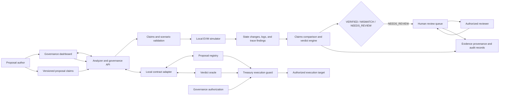

# Veritas Gate Architecture Plan

## 1. Purpose

Veritas Gate is designed to help governance participants inspect a proposal's declared effects, compare them with evidence from local EVM execution, route uncertain results for human review, and enforce execution safeguards through Solidity contracts.

The system separates evidence collection, verdict evaluation, human decisions, and on-chain execution. A simulation result is evidence for the decision process; it is not itself authorization to execute a proposal.

> **Safety notice:** This project is intended for local development and evaluation. It has not been audited or designed for production use. Do not use it to secure live funds or deploy it to a public network.

## 2. Architectural goals

1. **Explicit proposal intent:** Represent expected and prohibited effects in a versioned, validated claims document.
2. **Deterministic analysis:** Compare declared claims with simulation evidence using consistent verdict rules.
3. **Fail closed:** Missing, malformed, incomplete, or ambiguous evidence must not be treated as a clean verification.
4. **Reviewable decisions:** Preserve reviewer decisions, evidence provenance, and proposal history.
5. **Execution integrity:** Bind execution to registered proposal versions, calldata, verdict eligibility, and challenge state.
6. **Local boundaries:** Keep simulation RPC connections restricted to local EVM nodes.

## 3. System context and data flow



### Analysis flow

1. A proposal and its claims are submitted through the dashboard or API.
2. The API validates the input schema, addresses, integer amounts, required fields, and claim identifiers.
3. The simulator executes the scenario against a local EVM and collects available state changes, logs, and execution traces.
4. Trace rules classify security-sensitive operations and report when trace evidence is incomplete.
5. The comparison engine evaluates claims against observed effects and trace findings:
   - `MISMATCH` when reliable evidence shows a material violation.
   - `NEEDS_REVIEW` when evidence is incomplete, uncertain, or indicates a risky operation.
   - `VERIFIED` only when all required claims match and evidence is sufficiently complete.
6. Results and supporting evidence are recorded. `NEEDS_REVIEW` proposals are routed to the review queue.
7. Authorized reviewers record a reasoned decision; review history is retained.

### Execution flow

1. Governance authorizes a specific proposal version, target, and native value.
2. The proposal registry and verdict oracle hold the versioned commitments and decision state.
3. The Treasury guard checks authorization, replay status, target and value, calldata and proposal commitments, verdict eligibility, challenge state, and pause status.
4. Execution is performed using a normal EVM call. The guard does not expose unrestricted delegatecall execution.
5. A 2-of-3 guardian quorum can pause execution in an emergency.

## 4. Component plan

| Layer | Components | Responsibility |
| --- | --- | --- |
| User interface | `dashboard/` | Present proposals, simulation evidence, findings, review actions, and governance status. |
| API and application services | `analyzer/server.py` | Provide proposal, analysis, review, audit, and status endpoints; coordinate the analyzer services. |
| Claims and input validation | `analyzer/claims.py`, `analyzer/schemas.py` | Define versioned claims and scenario structures; reject invalid or ambiguous inputs. |
| Simulation and evidence | `analyzer/simulate.py`, `analyzer/trace_rules.py` | Run scenarios on a local EVM, collect state and trace evidence, and identify security-sensitive operations. |
| Verdict evaluation | `analyzer/compare.py` | Compare claims with evidence and produce `VERIFIED`, `MISMATCH`, or `NEEDS_REVIEW` with reason codes. |
| Review and provenance | `analyzer/review_queue.py`, `analyzer/provenance.py` | Persist review transitions and decisions, maintain audit records, and verify evidence content hashes. |
| Contract integration | `analyzer/contract_adapter.py` | Connect the API to deployed local registry and oracle contracts. |
| On-chain controls | `contracts/ProposalRegistry.sol`, `contracts/VerdictOracle.sol`, `contracts/GuardedTreasury.sol` | Maintain proposal commitments, verdict and challenge state, and guarded execution rules. |

## 5. Data and trust boundaries

| Boundary | Data crossing it | Required treatment |
| --- | --- | --- |
| Author to API | Proposal metadata, claims, scenario inputs, and evidence references | Validate types, required fields, schema versions, addresses, amounts, and payload size. |
| API to local EVM | Scenario transactions and read requests | Restrict RPC destinations to loopback addresses; isolate stateful simulation with snapshots and restoration. |
| Simulator to verdict engine | State changes, logs, trace findings, errors, completeness indicator | Preserve raw values and distinguish missing evidence from zero-valued state. |
| API to reviewer | Verdict, reason codes, evidence, and proposal context | Require configured reviewer authorization and a non-empty decision rationale. |
| API to contracts | Proposal version, hashes, verdict/review state, and execution metadata | Use the contract adapter and enforce on-chain authorization independently of API output. |
| Treasury to target | Authorized target, value, and calldata | Enforce commitment, replay, challenge, and pause checks before execution. |

Local JSON persistence is used for proposal records, review queue state, and provenance manifests. Hash verification establishes whether stored or submitted bytes match an expected digest; it does not establish the truth of their contents.

## 6. Interface and decision contracts

- **Claims:** `veritas-claims-v1.0`, defined by [analyzer/claims.py](analyzer/claims.py).
- **Simulation and verdict interfaces:** See [docs/SIMULATION_INTERFACE.md](docs/SIMULATION_INTERFACE.md).
- **Verdict outcomes:** `VERIFIED`, `MISMATCH`, and `NEEDS_REVIEW`.
- **Amounts:** Exact non-negative integer values; token decimals are not applied implicitly by the claims parser.
- **Addresses:** Valid 20-byte hexadecimal EVM addresses, normalized by the claims parser.
- **Evidence:** Incomplete trace or missing required evidence remains explicit and must not be interpreted as a clean result.

## 7. Implementation stages

This sequence describes the intended architecture dependency order:

1. **Define interfaces:** Stabilize claims, scenario, simulation-result, and verdict schemas.
2. **Build the analysis core:** Validate inputs, collect local execution evidence, apply trace rules, and compare claims with effects.
3. **Expose application workflows:** Provide API routes for proposal registration, analysis, reviews, provenance, and audit history.
4. **Add the governance interface:** Connect the dashboard to API operations and present evidence and decision state clearly.
5. **Enforce execution constraints:** Connect proposal commitments and verdict state to the Treasury guard, including challenge and guardian controls.
6. **Harden and verify:** Exercise component boundaries, failure cases, persistence recovery, contract invariants, and operational constraints.

## 8. Local development

### Requirements

- Python 3.10 or newer
- Dependencies listed in `requirements.txt`
- Foundry, including Anvil, for local EVM simulation and Solidity commands
- Node.js for dashboard logic checks

### Install

#### Windows PowerShell

```powershell
python -m venv .venv
.venv\Scripts\Activate.ps1
pip install -r requirements.txt
```

#### macOS or Linux

```bash
python3 -m venv .venv
source .venv/bin/activate
pip install -r requirements.txt
```

### Start the application

```bash
python run.py
```

Default local endpoints:

- Dashboard: [http://localhost:3000](http://localhost:3000)
- API: [http://127.0.0.1:5000](http://127.0.0.1:5000)
- Health status: [http://127.0.0.1:5000/health](http://127.0.0.1:5000/health)

The API and dashboard can also be started separately:

```bash
python run.py --api-only
python run.py --dashboard-only
```

Start Anvil separately when running EVM scenarios. The simulator is designed to connect only to a local RPC endpoint.

### Verification commands

```bash
python -m pytest
node --test tests/frontend/test_dashboard_logic.test.mjs
forge test -vv
```

## 9. Operational constraints

- The API and dashboard do not provide production-grade public authentication or transport security.
- Local configuration determines reviewer authorization; protect the local environment and its persisted records.
- Trace capabilities depend on the EVM client. Unavailable trace information must remain visible as inconclusive.
- The contracts and off-chain services have not undergone an independent security audit.
- Treat analysis outcomes as decision support, not as a substitute for governance authorization or a security assessment.
